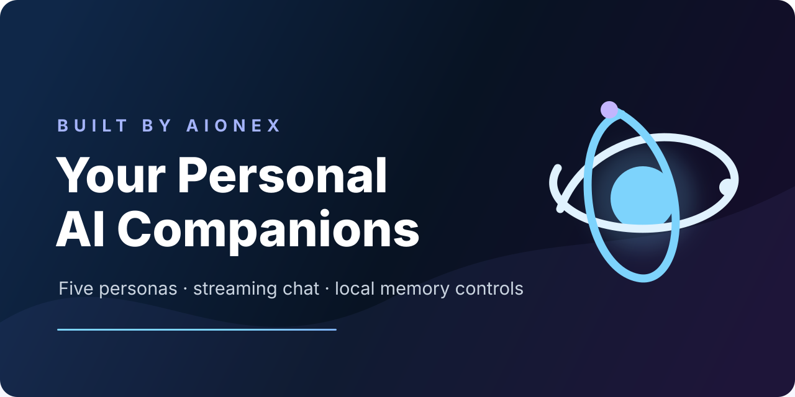
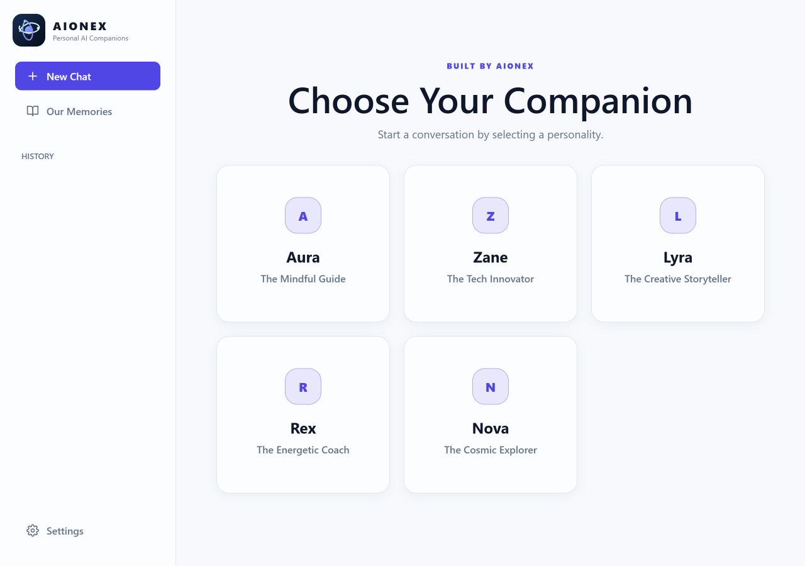
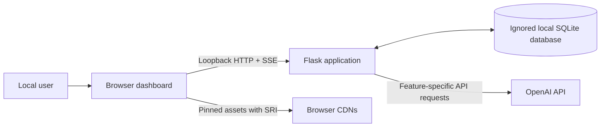

# AIONEX: Your Personal AI Companions

<p align="center">
  
</p>

<p align="center">
  <strong>Five distinct AI personas, one privacy-conscious local conversation space.</strong><br>
  A local-first Flask demonstration of streamed dialogue, opt-in memory, multilingual experiences, summaries, mood reflection, and speech.
</p>

<p align="center">
  
  
  
  
</p>

<p align="center"><strong>Built by AIONEX</strong></p>

## The experience

AIONEX turns a familiar chat interface into a small product laboratory for more coherent, character-led AI interaction. Instead of one generic voice, the user chooses among five intentionally different companions. Each persona changes the tone, visual theme, conversation starters, and speech voice category while the core interface remains consistent.

The project is designed for developers, product teams, technical reviewers, and organizations evaluating conversational AI patterns on a trusted workstation. It demonstrates real integration and product decisions without presenting the preview as a hosted service or production architecture.

<p align="center">
  
</p>

## Why it matters

General-purpose chat can feel disconnected across sessions and inconsistent in tone. AIONEX explores a more deliberate approach:

- persona design makes interaction style explicit;
- streamed responses provide immediate feedback;
- local history preserves continuity;
- personal memory is off by default and enabled only by user choice;
- stored facts remain visible and individually removable; and
- secondary tools—summaries, mood reflection, daily check-ins, and speech—share one coherent interface.

This makes the repository useful as both a working AI application and a transparent case study in the tradeoffs behind personalization, privacy, model output, and local persistence.

## Companion roster

| Persona | Role | Conversation style |
| --- | --- | --- |
| Aura | Mindful guide | Calm, reflective, and empathetic |
| Zane | Tech innovator | Logical, concise, and future-focused |
| Lyra | Creative storyteller | Imaginative, expressive, and metaphor-rich |
| Rex | Energetic coach | Motivating, direct, and playful |
| Nova | Cosmic explorer | Curious, adventurous, and idea-driven |

## Verified capabilities

- Token-streamed persona conversations over Server-Sent Events.
- Local SQLite conversation history with scoped read and delete operations.
- Privacy-first personal memory opt-in, fact review, and per-fact deletion.
- Generated shared memories for eligible conversations when memory is enabled.
- On-demand conversation summaries and mood reflection.
- Persona-category voice selection for OpenAI text-to-speech playback.
- Six interface and response languages: English, Spanish, French, Arabic, Chinese, and Hindi.
- Light and dark modes, persona themes, responsive layouts, keyboard access, reduced-motion support, and right-to-left presentation.
- Sanitized Markdown output, syntax highlighting, input bounds, loopback host/origin checks, and security response headers.

All AI-powered functions require the operator's own OpenAI API access and may incur provider charges.

## Architecture



The browser owns view state, localization, safe Markdown presentation, audio playback, and user preferences. Flask validates requests, scopes records to the configured local user, orchestrates model calls, streams responses, and persists local data. A bounded in-process worker pool handles opt-in fact extraction and shared-memory generation.

See [Architecture](docs/ARCHITECTURE.md) for routes, data relationships, trust boundaries, and the full chat sequence.

## Technology

| Layer | Components |
| --- | --- |
| Backend | Python 3.10+, Flask 3.1, OpenAI Python SDK |
| Frontend | Semantic HTML, modern CSS, vanilla JavaScript |
| Persistence | SQLite |
| Streaming | Server-Sent Events over `fetch()` streams |
| Browser presentation | Marked 18.0.9, Highlight.js 11.11.1, local allowlist sanitizer |
| Quality | Pytest, Ruff, Bandit, pip-audit, CodeQL, Dependabot |

Default models are configurable and currently set to `gpt-4o-mini`, `tts-1`, and `omni-moderation-latest`. Availability, behavior, pricing, and retention are controlled by the external provider and can change.

## Project structure

```text
app.py                  Flask app, routes, persistence, and AI orchestration
templates/dashboard.html Accessible application shell
static/                 Interface logic, styles, and original AIONEX mark
tests/                  Route, database, stream, and frontend security checks
docs/                   Architecture, privacy, case study, and visual assets
.github/                CI, CodeQL, Dependabot, and community templates
```

## Run locally

### Requirements

- Python 3.10–3.13
- Git
- An OpenAI API key with access to the configured models
- A current desktop browser

Clone this repository using GitHub's **Code** menu, then open a terminal in the cloned `aionex-ai-companions` directory.

### Windows PowerShell

```powershell
py -3.12 -m venv .venv
.\.venv\Scripts\Activate.ps1
python -m pip install --requirement requirements.txt
Copy-Item .env.example .env
```

### macOS or Linux

```bash
python3 -m venv .venv
source .venv/bin/activate
python -m pip install --requirement requirements.txt
cp .env.example .env
```

Edit the local `.env` file and set:

```dotenv
OPENAI_API_KEY=your_openai_api_key_here
FLASK_SECRET_KEY=generate_a_secure_random_value_here
```

Use a password manager or cryptographically secure generator to create a unique Flask secret of at least 32 characters. Never commit `.env`; it is ignored by Git.

Start the application:

```bash
python app.py
```

Open [http://127.0.0.1:5000](http://127.0.0.1:5000). A non-sensitive readiness endpoint is available at [http://127.0.0.1:5000/api/health](http://127.0.0.1:5000/api/health).

The documented startup path is intentionally `python app.py`. The app validates required configuration, initializes its schema, binds to loopback, and keeps debug mode off by default.

## Configuration

| Variable | Required | Default | Purpose |
| --- | --- | --- | --- |
| `OPENAI_API_KEY` | Yes | — | Server-side OpenAI API access |
| `FLASK_SECRET_KEY` | Yes | — | Flask cryptographic state |
| `AIONEX_DATABASE_PATH` | No | `memory.db` | Ignored local SQLite location |
| `AIONEX_LOCAL_USER_ID` | No | `local-user` | Record-scoping label; not authentication |
| `AIONEX_CHAT_MODEL` | No | `gpt-4o-mini` | Chat, summary, mood, check-in, and memory model |
| `AIONEX_TTS_MODEL` | No | `tts-1` | Speech model |
| `AIONEX_MODERATION_MODEL` | No | `omni-moderation-latest` | Moderation model |
| `AIONEX_PORT` | No | `5000` | Local listening port |
| `AIONEX_DEBUG` | No | `false` | Local debugging; do not enable with sensitive data |

## Using the app

1. Choose a companion.
2. Start a new conversation or select a starter prompt.
3. Open **Settings** to choose language, theme, and whether future chats may create personal memories.
4. Revisit conversations from **History**.
5. Use the chat-header controls for a summary or mood reflection after a conversation exists.
6. Use **Our Memories** and the Settings memory list to inspect generated summaries and stored facts.

Memory stays disabled until explicitly enabled. Turning it off stops future fact extraction and excludes existing facts from chat and check-in prompts; it does not delete data already stored.

## Test and review

Install the pinned development tools, then run the same core checks as CI:

```bash
python -m pip install --requirement requirements-dev.txt
python -m ruff check .
python -m pytest -q
python -m bandit -q -r app.py
python -m pip_audit --requirement requirements.txt
```

CI tests Python 3.10, 3.11, 3.12, and 3.13. CodeQL and Dependabot provide additional repository-level analysis.

## Security and privacy

AIONEX stores conversations and derived memory in a plaintext local SQLite file. Relevant content is sent to the configured OpenAI API when an AI-backed feature is used. The dashboard also downloads pinned Marked and Highlight.js resources from third-party CDNs. Do not enter confidential, regulated, clinical, legal, financial, employment, or emergency information.

The application has no login, authorization system, tenant isolation, rate limiting, spend controls, encrypted storage, retention scheduler, or durable background queue. Its host and origin checks reduce local-service exposure but do not make it suitable for a shared network or public deployment.

- Read [Privacy notes](docs/PRIVACY.md) before using real conversation content.
- Read [Security policy](SECURITY.md) for reporting and supported use.
- Keep `.env`, databases, logs, screenshots with chats, and generated local data private.
- Rotate any credential that may previously have been committed or shared.

For provider-specific data handling, consult the current [OpenAI API data controls documentation](https://developers.openai.com/api/docs/guides/your-data).

## Deployment guidance

Version 0.1.0 is a loopback-only, single-user demonstration. Do not expose the Flask development server to a LAN or the public internet. A shared or hosted edition requires authentication and authorization, per-user isolation, abuse and spend controls, a production WSGI server, durable jobs, managed data storage, encryption and retention decisions, monitoring, provider review, and an environment-specific threat model.

## Product use cases

- Evaluating persona and tone systems for conversational products.
- Prototyping local AI companion interaction patterns.
- Demonstrating streamed AI responses and derived conversation tools.
- Reviewing user-controlled personalization and memory UX.
- Exploring multilingual, speech-enabled interfaces before a production redesign.

## Documentation

- [Architecture](docs/ARCHITECTURE.md)
- [Privacy notes](docs/PRIVACY.md)
- [Customer-facing case study](docs/CASE_STUDY.md)
- [Roadmap](ROADMAP.md)
- [Changelog](CHANGELOG.md)
- [Contributing](CONTRIBUTING.md)
- [Support](SUPPORT.md)
- [Third-party notices](THIRD_PARTY_NOTICES.md)

## Current limitations

- Experimental v0.1.0 release; APIs and schema are not stable.
- Requires network access and a separately billed OpenAI API account for AI features.
- Single trusted local user only; no authentication or multi-user support.
- Plaintext SQLite with no migrations, backup automation, export, bulk deletion, or forensic-erasure guarantee.
- Best-effort in-process background work can be lost on restart.
- CDN availability is required for Markdown parsing and code highlighting.
- Personas are interface and prompt constructs, not people or professional advisers.

## Roadmap

Priorities include broader failure-path and accessibility verification, local browser dependencies, schema migrations, memory export and bulk deletion, cost transparency, and—before any shared deployment—a purpose-built identity, data, and operations architecture. See the full [roadmap](ROADMAP.md).

## Contributing and support

This is a proprietary source-available preview. Review [CONTRIBUTING.md](CONTRIBUTING.md) before proposing a change and use the configured issue forms for reproducible bugs, feature ideas, questions, or commercial inquiries. Do not put credentials, private conversations, or confidential business details in a public issue.

## License

Copyright © 2026 AIONEX. All rights reserved.

Source visibility does not grant permission to copy, modify, distribute, sublicense, host, or commercially use the project except where the [LICENSE](LICENSE) explicitly permits it. Third-party components remain under their own terms; see [THIRD_PARTY_NOTICES.md](THIRD_PARTY_NOTICES.md).

## Built by AIONEX

AIONEX designs and engineers intelligent applications, AI automation, integrations, and product experiences. For custom software, product engineering, or partnership inquiries, use the verified repository channels and the commercial inquiry form provided here.
