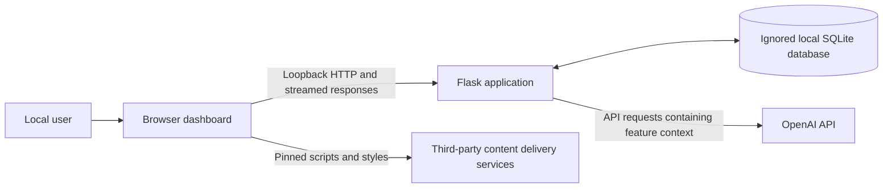
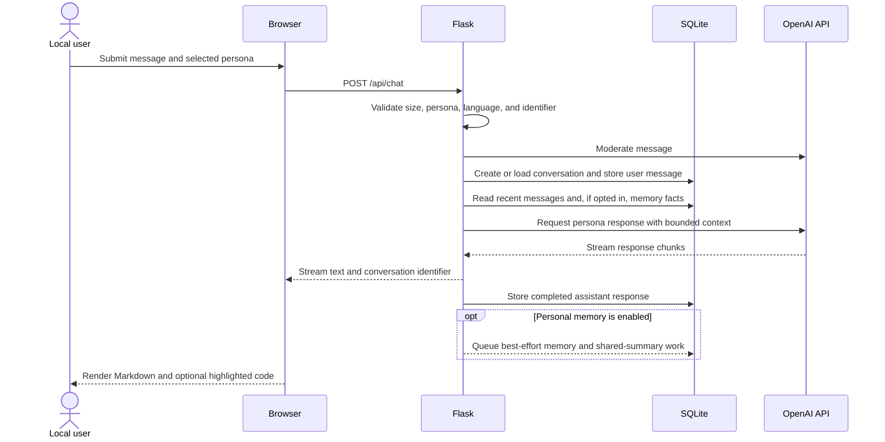

# AIONEX: Your Personal AI Companions architecture

## Status and scope

Version 0.1.0 is a local, single-user Flask demonstration. The architecture is
intentionally compact so the persona, streaming, memory, and speech experiences
can be evaluated on one trusted workstation. It is not a reference architecture
for an internet-facing or multi-user service.

## System context

The browser and Flask process are treated as belonging to the same local user.
There is no login boundary between them. The OpenAI API and content delivery
services are separate external trust boundaries.

## Repository components

| Component | Responsibility |
| --- | --- |
| `app.py` | Configuration, Flask routes, SQLite access, persona definitions, OpenAI calls, streaming, and background memory tasks |
| `templates/dashboard.html` | Server-rendered page shell and semantic UI structure |
| `static/script.js` | View state, localization, requests, streaming display, Markdown rendering, speech playback, and memory controls |
| `static/style.css` | Responsive layout, persona themes, dark mode, and component styling |
| Local SQLite file | Conversation metadata, messages, inferred memory facts, and shared-memory summaries |
| OpenAI API | Moderation, generated conversation, summarization, mood analysis, check-ins, memory extraction, and speech synthesis |

The application is a single Python module rather than a layered service. That
keeps the preview approachable but couples transport, persistence, and AI
orchestration concerns.

## Configuration

Runtime configuration is read from process environment variables, with `.env`
used only as a local convenience. Important values include:

- `OPENAI_API_KEY` for all AI-backed operations;
- `FLASK_SECRET_KEY` for Flask cryptographic state;
- `AIONEX_DATABASE_PATH` for the ignored SQLite location; and
- application-specific model and local-user settings documented in
  `.env.example`.

Credentials must never be sent to the browser, logged, committed, or placed in
the database. Missing required credentials should produce a controlled error
without exposing configuration values.

## Data model

The database schema is created at local startup and contains four logical
entities:

| Table | Purpose | Relationship |
| --- | --- | --- |
| `conversations` | Persona, title, local user identifier, and creation time | Parent of messages and shared memories |
| `messages` | User and assistant message bodies with timestamps | Belongs to one conversation |
| `long_term_memory` | JSON object of inferred facts for the local user | Keyed by local user identifier |
| `shared_memories` | One generated reflective summary for an eligible conversation | Belongs to one conversation |

SQLite is used as plaintext local storage. The schema has no migration framework
and is not designed for concurrent workers or tenant isolation.

## Request surface

The routes are an internal browser API and are not a versioned public API.

| Method and path | Purpose |
| --- | --- |
| `GET /` | Render the dashboard |
| `GET /api/health` | Return a non-sensitive local configuration readiness signal |
| `GET /api/history` | List local conversation metadata grouped by persona |
| `GET /api/conversation/<id>` | Load messages for a conversation |
| `DELETE /api/conversation/<id>` | Delete a conversation and linked records |
| `POST /api/chat` | Validate a message and stream a persona response |
| `POST /api/tts` | Convert bounded text to synthesized speech |
| `POST /api/summarize` | Stream a conversation summary |
| `POST /api/analyze_mood/<id>` | Analyze user-authored messages in a conversation |
| `POST /api/daily_checkin` | Generate a persona check-in from supplied local context |
| `GET /api/shared_memories` | List generated shared-memory summaries |
| `GET /api/memory` | Return inferred local memory facts |
| `DELETE /api/memory` | Delete one selected memory fact |

Because v0.1.0 has no authentication, the configured local-user identifier and
record-scoping queries are not an identity boundary. Any caller that can reach
the server can act as that local user, so the server must remain reachable only
by the trusted local operator.

## Main chat flow

Model calls fail independently of local page rendering. The OpenAI provider may
reject a request, time out, enforce a quota, or return content that needs safe
handling. A partially streamed response and a stored response can diverge if the
process exits unexpectedly.

## Other feature flows

- **Speech:** bounded text and persona information go to Flask; Flask requests
  speech synthesis and returns audio bytes without intentionally persisting the
  audio.
- **Summarization and mood analysis:** stored conversation content is selected
  locally, then sent to the configured model for derived output.
- **Daily check-in:** the browser requests a generated greeting using the
  selected persona and language, plus memory context only after opt-in.
- **Memory extraction:** when personal memory is enabled, recent conversation
  content is analyzed by a bounded in-process worker pool; structured facts may
  be merged into the local memory record.
- **Shared memories:** sufficiently long conversations may be summarized by
  best-effort in-process work and persisted once per conversation.

The background worker pool has no durable queue, retry policy, cancellation model,
or cross-process coordination. A process stop can abandon pending work.

## Browser state and external resources

The browser stores theme, language, personal-memory opt-in, and per-persona last-visit dates in
`localStorage`. Conversation content is not intentionally stored there. Marked
parses model Markdown, an allowlist sanitizer filters the result, and Highlight.js
formats code blocks. Those libraries are loaded from external providers with
exact versions and integrity hashes, so the interface still depends on their
availability and integrity.

## Security and privacy boundaries

1. **Browser input is untrusted.** Validate JSON shape, length, enumeration
   values, identifiers, and record ownership at the server.
2. **Model output is untrusted.** Rendering and copy/speech features must not
   treat generated markup or instructions as trusted code.
3. **The database is sensitive.** It can contain private conversation content
   and inferred personal facts; it must remain ignored and access-restricted.
4. **The provider boundary is external.** Only necessary context should be sent,
   and users must understand that local deletion cannot delete provider-side
   records.
5. **Moderation is not authorization.** Content screening cannot replace access
   control, request limits, or human judgment.

See [PRIVACY.md](PRIVACY.md) and [SECURITY.md](../SECURITY.md) for operational
details.

## Production gap

Before shared or hosted use, the architecture needs a reviewed authentication
and authorization model, per-user ownership enforcement, hardened request and
response handling, a production WSGI server, durable background jobs, managed
data storage and migrations, encryption and retention controls, observability,
rate limits, dependency hardening, backup/recovery, and an environment-specific
threat model. These are planned directions, not implemented capabilities.
